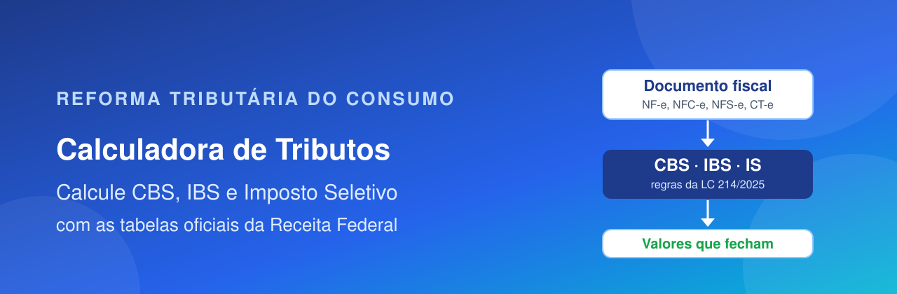

<p align="center">
  
</p>

<p align="center">
  <a href="https://github.com/ReceitaFederal/calculadora-rtc-regime-regular/tags"></a>
  
  
  
  
</p>

<h3 align="center">Calcule CBS, IBS e Imposto Seletivo<br>com as tabelas oficiais da Receita Federal</h3>

---

## O que é

A Calculadora de Tributos é uma API que faz as contas da Reforma Tributária do Consumo (LC 214/2025) no regime geral. Você envia os dados da operação e recebe os valores de CBS, IBS e Imposto Seletivo. Ela também consulta as tabelas oficiais usadas no cálculo e gera e valida os trechos de tributação dos documentos fiscais eletrônicos.

É mantida pela Receita Federal do Brasil, com o SERPRO.

## Por que usar

| | |
|---|---|
| **Cálculo pronto** | CBS, IBS e Imposto Seletivo em uma chamada. |
| **Resultado que fecha** | Os totais batem com a soma dos itens exibidos, como a autorização da nota exige. |
| **Erros por item** | Em um modo à parte, um item com erro não impede o cálculo dos outros. |
| **Tabelas oficiais** | CST, cClassTrib, NCM, NBS, alíquotas e fundamentações legais por consulta. |
| **XML do documento fiscal** | Gera o grupo de tributação e valida contra o XSD (NF-e, NFC-e, CT-e e outros). |
| **Documentação interativa** | Swagger com todos os campos e exemplos. |

## Antes de começar

- **Java 25**. Confira com `java -version`.
- **Git**, para baixar o projeto.
- **Internet** na primeira execução: o Maven Wrapper (`mvnw`) baixa o Maven sozinho, sem instalação.
- Windows, macOS ou Linux.

## Instalação

```bash
git clone https://github.com/ReceitaFederal/calculadora-rtc-regime-regular.git
cd calculadora-rtc-regime-regular
```

**Passo obrigatório: gerar o banco de dados.** Sem ele, a aplicação não inicia.

Linux/macOS:

```bash
mkdir -p ./calculadora/db
./mvnw flyway:migrate -Dflyway.configFiles=./flyway/flyway-pro.conf --batch-mode --errors
```

Windows:

```bat
mkdir calculadora\db
mvnw.cmd flyway:migrate -Dflyway.configFiles=flyway\flyway-pro.conf --batch-mode --errors
```

## Como usar

Inicie a aplicação:

```bash
./mvnw spring-boot:run -Dspring-boot.run.profiles=offline
```

No Windows: `mvnw.cmd spring-boot:run "-Dspring-boot.run.profiles=offline"`.

Ela fica em `http://localhost:8080/api`. A documentação interativa está em `http://localhost:8080/api/swagger-ui.html`.

| Para | Chamada |
|---|---|
| Calcular os tributos | `POST /api/calculadora/regime-geral` |
| Calcular com erros por item | `POST /api/calculadora/observabilidade/regime-geral` |
| Gerar o XML a partir do cálculo | `POST /api/calculadora/xml/generate?tipo=nfe` |
| Validar um XML | `POST /api/calculadora/xml/validate?tipo=nfe&subtipo=grupo` |
| Consultar NCM | `GET /api/calculadora/dados-abertos/ncm` |

A lista completa e exemplos de envio estão em [docs/exemplos.md](docs/exemplos.md).

Para rodar os testes e ver a cobertura: `./mvnw clean test jacoco:report` (relatório em `target/site/jacoco/index.html`). Os testes também precisam do banco gerado.

## Segurança e privacidade

- A aplicação só lê o banco de dados. Ela nunca altera as tabelas oficiais.
- A configuração de segurança deste projeto libera todas as rotas e serve para homologação e testes. Não exponha a API na internet sem revisar isso.
- Para relatar uma falha de segurança, veja [SECURITY.md](SECURITY.md).

## Versões

| Versão | Novidades |
|---|---|
| 1.7.2 | O resultado do cálculo passa a fechar consigo mesmo: totais batem com a soma dos itens exibidos (evita a rejeição 1091). Podem surgir diferenças de centavos em relação à 1.7.0. |
| 1.6.1 | Atualização do ROADMAP. |

O histórico completo está no [CHANGELOG](CHANGELOG.md).

## Para quem quer contribuir

Este repositório não aceita Pull Requests de fora. Sugestões e relatos de erro entram por Issues e Discussions. Veja o [guia de contribuição](CONTRIBUTING.md) e a [governança](GOVERNANCE.md).

## Licença

[MIT](LICENSE)
