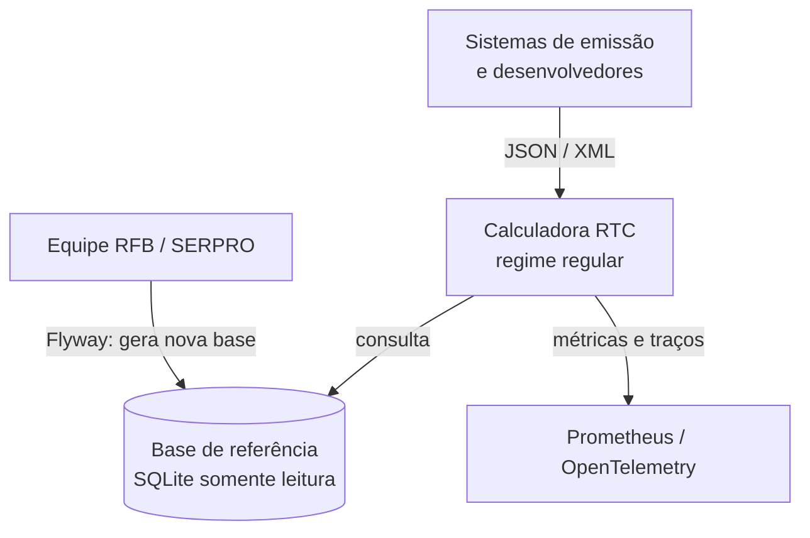
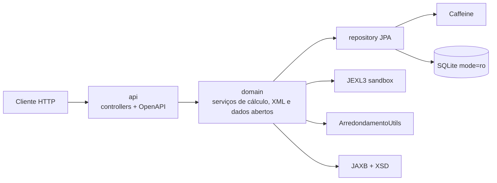

# Overview — calculadora-rtc-regime-regular

API REST em Java 25 e Spring Boot 4, mantida pela Receita Federal e pelo SERPRO. Calcula CBS, IBS e Imposto Seletivo (LC 214/2025) no regime geral, expõe as tabelas oficiais do cálculo e gera e valida os grupos de tributação dos documentos fiscais eletrônicos. Regras tributárias vivem em dados (expressões JEXL); o banco de referência é SQLite somente leitura.

## Índice
- `stack.md` — tecnologias e layout
- `modules.md` — componentes
- `flows.md` — fluxos principais
- `decisions.md` — decisões e índice de ADRs
- `concepts.md` — um conceito, uma casa (`DUP-01`)

---

## Arquitetura (C4 Model)

### Nível 1: Contexto

### Nível 2: Containers

